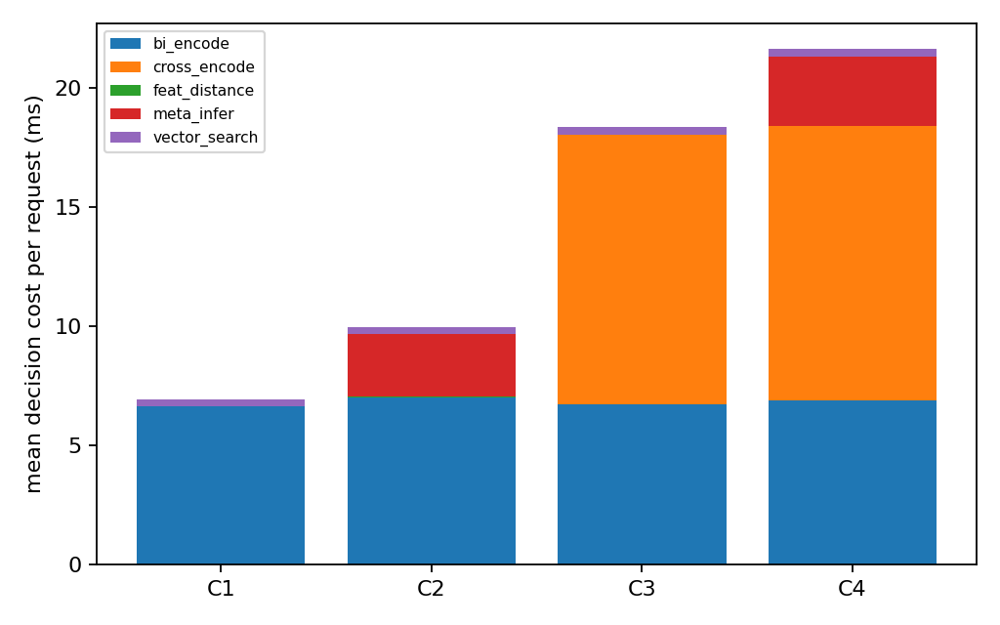
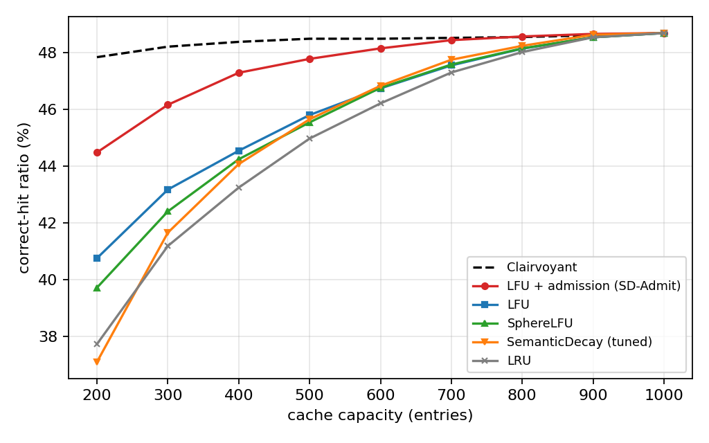
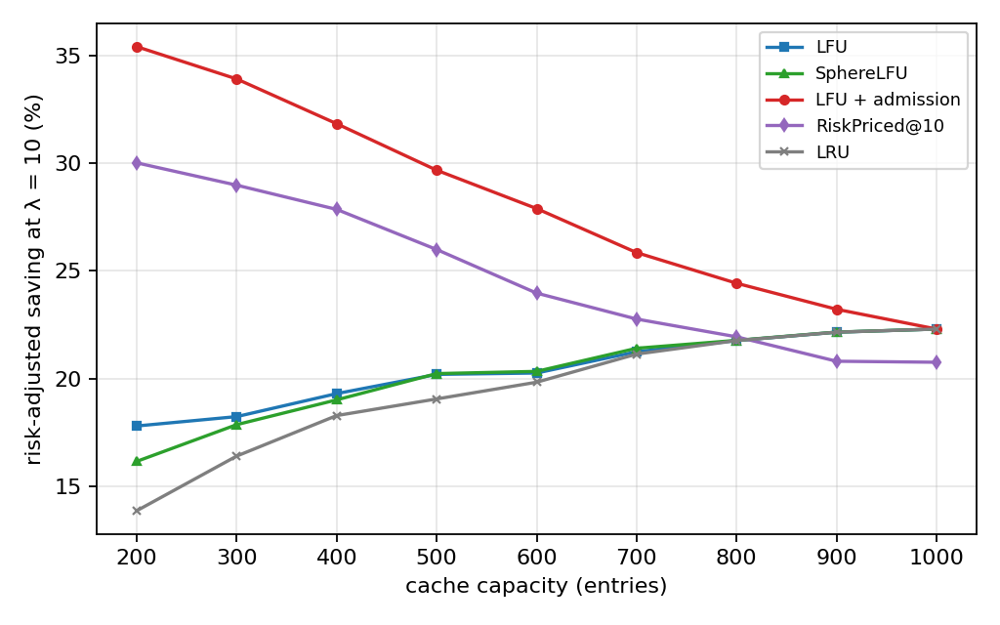
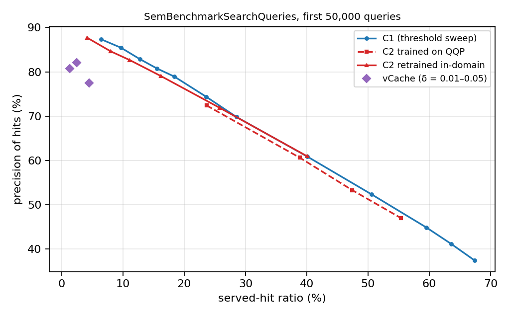
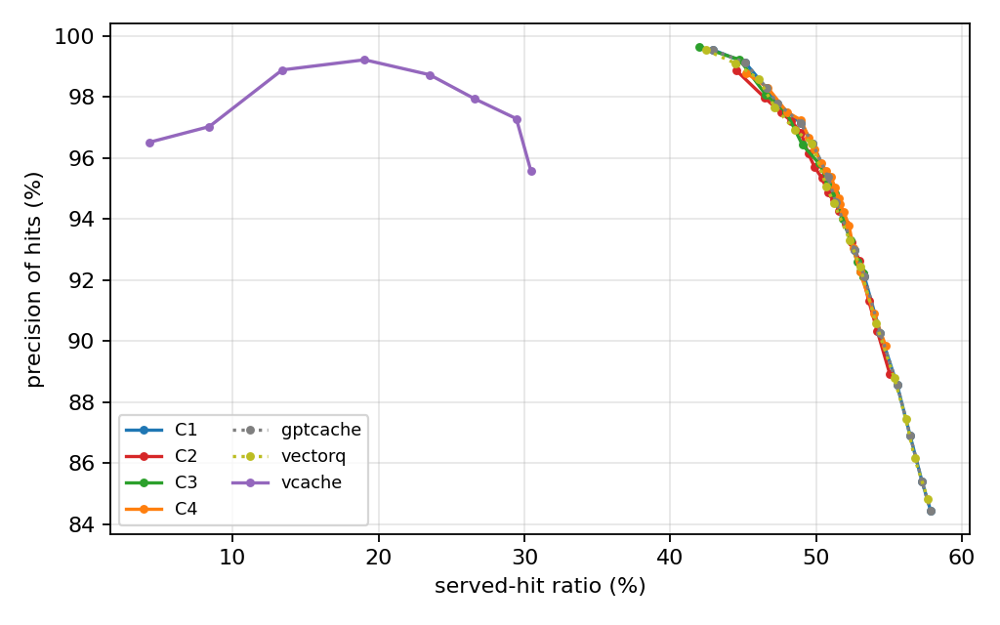

# Revision evidence pack

Every table below is generated by `scripts/build_evidence_pack.py` from the result files in
`results/raw/revision/`. Re-run the script after any new result. Figures are in `results/revision/figures/`.

**Protocol common to all runs.** Labels use the corrected stream generator (one stable label per distinct
question; distractors drawn from never-emitted strings). QQP streams: 2,000 requests, seeds 42–46 for
evaluation, seed 1042 reserved for tuning. Served LLM gpt-5.4-nano, answers capped at 256 tokens. Response
times come from replay with real generation waits; quality-only sweeps use memoised encoders and report no
latency. C2 serving uses single-threaded LightGBM inference and batched candidate scoring.

**Status by comment**

| Comment | Topic | Evidence | Status |
|---|---|---|---|
| R1.1 | Why C2, not C1 | exp11, exp12, exp16, exp22, exp25 | evidence complete; framing decision needed |
| R1.2 | Price of false hits | exp2, exp11, exp12, exp13 | complete |
| R1.3 | Latency generality | exp1, exp2, exp14, exp21 | complete |
| R1.4, R3.2, R3.4 | Semantic Decay | exp18, exp23, exp24, exp26 | evidence complete; framing decision needed |
| R1.5 | Synthetic workload | exp15, exp20, exp22, exp25 | complete |
| R2.1 | Related work | literature checks (§9) | writing |
| R2.2 | Figure 1 | – | writing |
| R2.3 | Full-mode overhead | exp1, exp14 | complete |
| R2.4 | 2026 baselines | exp12, exp19, exp20, exp21, exp22 | complete (RAC optional) |
| R2.5 | Language | – | writing |
| R3.1 | Top-k and gating | exp13, exp14 | complete |
| R3.3 | Baseline protocol | exp12, exp19 | complete |
| R3.5 | Additional experiments | exp13, exp16, exp17, exp19 | complete |
| R3.7 | Correctness beyond labels | exp16 | complete |

## 0. Corrections that change reported numbers (disclose)

Stream labels: shipped vs corrected labels on the same decisions, and the fresh-distractor stream (exp10, seed 42):

| config | precision, shipped labels | precision, corrected | precision, fresh-distractor stream | correct-only saving, shipped | corrected | break-even λ, shipped | corrected | same decisions |
|---|---|---|---|---|---|---|---|---|
| C1 | 76.2 | 88.6 | 92.1 | 51.0 | 58.5 | 3.4 | 7.7 | True |
| C2 | 77.0 | 92.6 | 94.8 | 50.5 | 60.1 | 3.6 | 13.0 | True |
| C3 | 76.8 | 91.7 | 94.3 | 50.6 | 59.7 | 3.5 | 11.3 | True |
| C4 | 77.4 | 93.6 | 95.0 | 50.5 | 60.3 | 3.7 | 14.8 | True |

Other disclosures: answers are capped at 256 tokens (both cached and fresh answers; token savings are
computed on capped answers); 88 of 3,586 answers for the 10,000-request stream failed to fetch and fall back to
simulated answers (hit decisions unaffected); SD-Admit's tie rule and slow-aging setting were added after an
inspection run on evaluation seed 42 (final settings chosen on the tuning stream only).

## 1. R1.1 — Why C2 rather than C1

Five seeds, real generation waits (exp11):

| config | hit ratio % [95% CI] | precision % | correct-only saving % | overhead ms | response s | break-even λ |
|---|---|---|---|---|---|---|
| C1 | 53.6 [52.5, 54.6] | 92.2 [90.7, 93.6] | 49.0 [46.1, 51.9] | 7.21 | 0.874 | 11.9 |
| C2 | 51.3 [50.0, 52.6] | 94.9 [94.0, 95.8] | 48.4 [45.4, 51.4] | 10.13 | 0.916 | 18.9 |
| C3 | 52.4 [51.2, 53.6] | 93.9 [92.7, 95.0] | 48.9 [46.0, 51.7] | 18.58 | 0.907 | 15.3 |
| C4 | 51.4 [50.3, 52.5] | 95.2 [94.4, 96.0] | 48.7 [45.6, 51.7] | 21.66 | 0.926 | 19.9 |
| C5 | 52.1 [51.0, 53.2] | 94.3 [93.1, 95.5] | 48.8 [45.8, 51.8] | 10.70 | 0.904 | 16.6 |

Precision (%) at the same served-hit ratio, mean ± sd over seeds 42–46, from full threshold sweeps on an extended grid (exp12 per seed, aggregated by exp27). All four configurations lie on one precision–coverage curve (Figure F3):

| served-hit ratio % | C1 | C2 | C3 | C4 |
|---|---|---|---|---|
| 45 | 99.18 ± 0.34 | 98.81 ± 0.51 | 98.97 ± 0.45 | 99.01 ± 0.41 |
| 50 | 96.32 ± 0.97 | 96.18 ± 1.01 | 96.21 ± 0.81 | 96.40 ± 1.03 |

Paired tests against C1 (matched precision and best risk-adjusted saving per λ), Holm-adjusted across all of them:

| test (config − C1) | Δ | 95% CI | p | Holm p |
|---|---|---|---|---|
| precision|45|C2_bi_geo_lgb-C1 | -0.37 | [-0.59, -0.16] | 0.009 | 0.198 |
| precision|45|C3_bi_cross-C1 | -0.22 | [-0.45, 0.02] | 0.063 | 0.980 |
| precision|45|C4_full_stacking-C1 | -0.17 | [-0.52, 0.18] | 0.250 | 1.000 |
| precision|50|C2_bi_geo_lgb-C1 | -0.14 | [-0.51, 0.22] | 0.340 | 1.000 |
| precision|50|C3_bi_cross-C1 | -0.11 | [-0.57, 0.35] | 0.536 | 1.000 |
| precision|50|C4_full_stacking-C1 | 0.08 | [-0.16, 0.31] | 0.412 | 1.000 |
| precision|55|C2_bi_geo_lgb-C1 | -0.53 | [-1.39, 0.32] | 0.116 | 1.000 |
| best_ras|0|C2_bi_geo_lgb-C1 | -0.14 | [-0.26, -0.01] | 0.036 | 0.615 |
| best_ras|0|C3_bi_cross-C1 | -0.17 | [-0.27, -0.06] | 0.012 | 0.246 |
| best_ras|0|C4_full_stacking-C1 | -0.01 | [-0.26, 0.24] | 0.907 | 1.000 |
| best_ras|1|C2_bi_geo_lgb-C1 | -0.02 | [-0.44, 0.40] | 0.913 | 1.000 |
| best_ras|1|C3_bi_cross-C1 | -0.03 | [-0.57, 0.51] | 0.892 | 1.000 |
| best_ras|1|C4_full_stacking-C1 | 0.22 | [-0.11, 0.54] | 0.139 | 1.000 |
| best_ras|2|C2_bi_geo_lgb-C1 | -0.29 | [-0.64, 0.06] | 0.083 | 1.000 |
| best_ras|2|C3_bi_cross-C1 | -0.37 | [-1.07, 0.33] | 0.213 | 1.000 |
| best_ras|2|C4_full_stacking-C1 | -0.03 | [-0.63, 0.57] | 0.892 | 1.000 |
| best_ras|5|C2_bi_geo_lgb-C1 | -0.73 | [-1.67, 0.21] | 0.097 | 1.000 |
| best_ras|5|C3_bi_cross-C1 | -0.74 | [-1.22, -0.25] | 0.014 | 0.266 |
| best_ras|5|C4_full_stacking-C1 | -0.35 | [-1.23, 0.52] | 0.323 | 1.000 |
| best_ras|10|C2_bi_geo_lgb-C1 | -1.25 | [-2.15, -0.35] | 0.018 | 0.329 |
| best_ras|10|C3_bi_cross-C1 | -1.18 | [-1.95, -0.42] | 0.013 | 0.256 |
| best_ras|10|C4_full_stacking-C1 | -0.97 | [-2.01, 0.07] | 0.061 | 0.980 |

Risk-adjusted saving (%) at each configuration's default threshold and at the threshold chosen for λ (mean of 5 seeds):

| λ | C1 default → tuned | C2 default → tuned | C3 default → tuned | C4 default → tuned |
|---|---|---|---|---|
| 0 | 49.0 → 49.2 | 48.4 → 49.1 | 48.9 → 49.1 | 48.7 → 49.2 |
| 1 | 44.8 → 46.1 | 45.8 → 46.1 | 45.6 → 46.1 | 46.2 → 46.3 |
| 2 | 40.5 → 44.8 | 43.2 → 44.5 | 42.2 → 44.4 | 43.6 → 44.7 |
| 5 | 27.7 → 42.7 | 35.4 → 42.0 | 32.3 → 42.0 | 36.1 → 42.4 |
| 10 | 6.3 → 41.4 | 22.3 → 40.1 | 15.8 → 40.2 | 23.5 → 40.4 |

C1 vs C2 at default thresholds, seed-level paired test (5 seeds):

| metric (C1 − C2) | Δ mean | 95% CI | paired t p |
|---|---|---|---|
| hit_ratio_pct | 2.25 | [1.69, 2.81] | 3.8e-04 |
| precision_of_hits_pct | -2.74 | [-3.74, -1.73] | 0.002 |
| false_discovery_rate_pct | 2.74 | [1.73, 3.74] | 0.002 |
| token_saving_correct_only_pct | 0.63 | [0.55, 0.71] | 2.3e-05 |
| avg_overhead_ms | -2.92 | [-2.98, -2.86] | 1.6e-08 |
| break_even_false_hit_cost | -7.06 | [-9.31, -4.81] | 9.6e-04 |

Summary of the evidence: at their default thresholds C2 is significantly more precise than C1 (and has the
highest answer-level precision in the judge audit, §7), but at equal served-hit ratio the configurations are
indistinguishable on QQP across five seeds, no configuration beats C1 once each threshold is chosen for λ (no
difference survives Holm adjustment), threshold choice is worth up to 35 points at λ = 10, and on a real
search-query log C2 never beats a re-thresholded C1, even after in-domain retraining (§5). What C2 adds is a
well-placed default operating point, not a better decision boundary.

## 2. R1.2 — Pricing false hits

Seed 42, real waits (exp2). RAS = risk-adjusted saving, where each false hit costs λ times the call it replaced:

| config | FDR % | false-hit rate % | RAS λ=0 | λ=1 | λ=2 | λ=5 | λ=10 | break-even λ |
|---|---|---|---|---|---|---|---|---|
| C1 | 7.9 | 4.20 | 51.3 | 47.1 | 43.0 | 30.5 | 9.8 | 12.4 |
| C2 | 5.2 | 2.65 | 50.7 | 48.1 | 45.6 | 37.9 | 25.0 | 19.8 |
| C3 | 5.7 | 2.95 | 51.0 | 48.0 | 45.0 | 36.1 | 21.3 | 17.2 |
| C4 | 5.0 | 2.55 | 51.1 | 48.5 | 46.0 | 38.3 | 25.5 | 20.0 |
| C5 | 5.6 | 2.90 | 51.0 | 48.2 | 45.3 | 36.7 | 22.5 | 17.9 |

## 3. R1.3 / R2.3 — Latency and its components

Decision-path cost (exp14, batch 1, 300 queries):

| config | mean ms | p50 | p95 | p99 |
|---|---|---|---|---|
| C1 | 6.93 | 6.87 | 7.26 | 8.12 |
| C2 | 10.05 | 10.00 | 10.49 | 11.53 |
| C3 | 18.37 | 18.25 | 19.26 | 20.15 |
| C4 | 21.71 | 21.27 | 22.53 | 23.30 |

Cross-encoder batching:

| cross-encoder batch | 1 | 2 | 4 | 8 | 16 | 32 |
|---|---|---|---|---|---|---|
| ms per pair | 11.00 | 5.80 | 3.04 | 1.70 | 1.29 | 1.37 |

Top-k cost (mean ms per request):

| config | k=1 | k=3 | k=5 | k=10 |
|---|---|---|---|---|
| C3 | 18.2 | 18.9 | 19.2 | 21.0 |
| C4 | 22.0 | 22.3 | 23.3 | 24.6 |
| C2 | 9.8 | 10.5 | 10.6 | 10.5 |

Concurrent clients:

| config | clients | mean ms | p95 | p99 | throughput rps |
|---|---|---|---|---|---|
| C1 | 1 | 7.5 | 8.2 | 8.7 | 132 |
| C1 | 4 | 25.7 | 31.2 | 32.8 | 153 |
| C1 | 16 | 132.2 | 143.9 | 148.1 | 120 |
| C2 | 1 | 11.4 | 11.7 | 16.0 | 88 |
| C2 | 4 | 36.2 | 46.8 | 111.5 | 109 |
| C2 | 16 | 182.7 | 248.4 | 269.3 | 87 |
| C4 | 1 | 22.4 | 23.7 | 24.0 | 45 |
| C4 | 4 | 80.5 | 94.0 | 100.5 | 49 |
| C4 | 16 | 420.8 | 486.5 | 511.6 | 38 |

End-to-end with real generation waits (exp2, 2,000 requests, seed 42; no cache: 2.694 s average):

| config | hit % | precision % | overhead ms | avg response s | p95 s | speed-up vs no cache | identity residual ms |
|---|---|---|---|---|---|---|---|
| C1 | 53.2 | 92.1 | 7.16 | 1.219 | 3.60 | 2.21 | -0.0 |
| C2 | 51.1 | 94.8 | 10.14 | 1.272 | 3.64 | 2.12 | 0.0 |
| C3 | 51.7 | 94.3 | 18.68 | 1.269 | 3.66 | 2.12 | 0.0 |
| C4 | 51.3 | 95.0 | 21.81 | 1.282 | 3.67 | 2.10 | -0.0 |
| C5 | 51.6 | 94.4 | 10.60 | 1.263 | 3.65 | 2.13 | 0.2 |

Per-component breakdown (exp1, batch 1):

| config | bi-encode ms | vector search ms | cross-encode ms | features + meta ms | total ms | × C1 | cross-encoder share % |
|---|---|---|---|---|---|---|---|
| C1 | 6.89 | 0.32 | – | – | 7.22 | 1.00 | 0.0 |
| C2 | 6.89 | 0.32 | – | 2.93 | 10.15 | 1.41 | 0.0 |
| C3 | 6.89 | 0.32 | 11.50 | – | 18.71 | 2.59 | 61.4 |
| C4 | 6.89 | 0.32 | 11.50 | 2.93 | 21.64 | 3.00 | 53.1 |

## 4. R1.4 / R3.2 / R3.4 — Eviction and admission

Correct-hit ratio (%) by capacity, C2 serving, mean of seeds 42–46:

| policy | 200 | 300 | 400 | 500 | 600 | 700 | 800 | 900 | 1000 |
|---|---|---|---|---|---|---|---|---|---|
| Clairvoyant (exp23) | 47.85 | 48.22 | 48.39 | 48.50 | 48.50 | 48.53 | 48.56 | 48.62 | 48.70 |
| LRU | 37.73 | 41.19 | 43.25 | 44.98 | 46.22 | 47.31 | 48.03 | 48.55 | 48.70 |
| LFU | 40.76 | 43.18 | 44.55 | 45.81 | 46.75 | 47.56 | 48.15 | 48.55 | 48.70 |
| SphereLFU | 39.72 | 42.41 | 44.25 | 45.55 | 46.77 | 47.59 | 48.16 | 48.55 | 48.70 |
| SemanticDecay_fixed | 36.17 | 40.78 | 43.60 | 45.51 | 46.76 | 47.67 | 48.27 | 48.60 | 48.70 |
| SemanticDecay_tuned | 37.10 | 41.66 | 44.08 | 45.66 | 46.84 | 47.76 | 48.25 | 48.64 | 48.70 |
| SemanticDecay2_tuned | 37.10 | 41.66 | 44.08 | 45.66 | 46.84 | 47.76 | 48.25 | 48.64 | 48.70 |
| SD-Admit (exp24) | 44.49 | 46.17 | 47.30 | 47.79 | 48.16 | 48.45 | 48.58 | 48.67 | 48.70 |
| SD-Admit_no_admission (exp24) | 40.70 | 43.11 | 44.66 | 45.96 | 47.05 | 47.78 | 48.41 | 48.66 | 48.70 |
| SD-Admit_no_demand (exp24) | 44.49 | 46.17 | 47.30 | 47.79 | 48.16 | 48.45 | 48.58 | 48.67 | 48.70 |

Headroom and what admission captures:

|  | 200 | 300 | 400 | 500 | 600 | 700 | 800 | 900 | 1000 |
|---|---|---|---|---|---|---|---|---|---|
| headroom over best online (pts) | 7.09 | 5.04 | 3.84 | 2.69 | 1.66 | 0.77 | 0.29 | -0.02 | 0.00 |
| best online policy | LFU | LFU | LFU | LFU | SemanticDecay_tuned | SemanticDecay_tuned | SemanticDecay_fixed | SemanticDecay_tuned | LRU |
| SD-Admit share of headroom captured (%) | 53 | 59 | 72 | 74 | 81 | 92 | 105 | – | – |

SD-Admit as frozen from the tuning stream: β = 0.0, radius 0.65, aging every 16× capacity requests, admission True (β = 0 switches neighbourhood demand off; all radii tie). Paired tests on correct-hit ratio (5 seeds):

| SD-Admit vs | 200 | 300 | 400 | 500 | 600 | 700 | 800 | 900 | 1000 |
|---|---|---|---|---|---|---|---|---|---|
| LFU | +3.73 (p 3.6e-07) | +2.99 (p 5.0e-05) | +2.75 (p 4.6e-05) | +1.98 (p 7.5e-04) | +1.41 (p 6.6e-04) | +0.89 (p 0.003) | +0.43 (p 0.022) | +0.12 (p 0.170) | +0.00 (p –) |
| SphereLFU | +4.77 (p 1.5e-05) | +3.76 (p 3.8e-06) | +3.05 (p 4.5e-05) | +2.24 (p 4.3e-04) | +1.39 (p 0.002) | +0.86 (p 0.006) | +0.42 (p 0.026) | +0.12 (p 0.153) | +0.00 (p –) |
| SemanticDecay_tuned | +7.39 (p 1.8e-04) | +4.51 (p 1.4e-04) | +3.22 (p 4.7e-05) | +2.13 (p 0.001) | +1.32 (p 0.001) | +0.69 (p 0.009) | +0.33 (p 0.032) | +0.03 (p 0.501) | +0.00 (p –) |

Semantic Decay (tuned weights) vs LRU and LFU:

| Semantic Decay (tuned) vs | 200 | 300 | 400 | 500 | 600 | 700 | 800 | 900 | 1000 |
|---|---|---|---|---|---|---|---|---|---|
| LRU | -0.63 (p 0.319) | +0.47 (p 0.262) | +0.83 (p 0.008) | +0.68 (p 0.026) | +0.62 (p 0.028) | +0.45 (p 0.106) | +0.22 (p 0.114) | +0.09 (p 0.137) | +0.00 (p –) |
| LFU | -3.66 (p 0.002) | -1.52 (p 0.004) | -0.47 (p 0.054) | -0.15 (p 0.288) | +0.09 (p 0.431) | +0.20 (p 0.218) | +0.10 (p 0.434) | +0.09 (p 0.137) | +0.00 (p –) |

Eviction-time density at capacity 400 (exp18):

| policy | victim neighbours within hit radius | victim topic still covered % | victim never hit % |
|---|---|---|---|
| LRU | 0.056 | 2.247 | 82.3 |
| LFU | 0.056 | 1.912 | 100.0 |
| SphereLFU | 0.044 | 1.447 | 94.6 |
| SemanticDecay_fixed | 0.044 | 1.800 | 82.9 |
| SemanticDecay_tuned | 0.035 | 1.520 | 88.0 |
| SemanticDecay2_tuned | 0.035 | 1.520 | 88.0 |

Pricing false hits (exp26): risk-adjusted saving (RAS, %) and false-hit rates, mean of 5 seeds:

| λ | capacity | RAS LFU | SphereLFU | LFU + admission | RiskPriced | false-hit % LFU | false-hit % LFU + admission | precision LFU | precision LFU + admission |
|---|---|---|---|---|---|---|---|---|---|
| 1 | 200 | 38.10 | 37.05 | 43.23 | 43.23 | 2.25 | 0.88 | 94.8 | 98.1 |
| 1 | 400 | 41.69 | 41.38 | 45.46 | 45.46 | 2.48 | 1.55 | 94.7 | 96.8 |
| 1 | 800 | 45.26 | 45.27 | 45.90 | 45.90 | 2.62 | 2.39 | 94.8 | 95.3 |
| 2 | 200 | 35.84 | 34.73 | 42.36 | 41.68 | 2.25 | 0.88 | 94.8 | 98.1 |
| 2 | 400 | 39.20 | 38.89 | 43.95 | 43.56 | 2.48 | 1.55 | 94.7 | 96.8 |
| 2 | 800 | 42.65 | 42.66 | 43.51 | 43.37 | 2.62 | 2.39 | 94.8 | 95.3 |
| 5 | 200 | 29.07 | 27.76 | 39.75 | 37.17 | 2.25 | 0.88 | 94.8 | 98.1 |
| 5 | 400 | 31.74 | 31.44 | 39.40 | 37.72 | 2.48 | 1.55 | 94.7 | 96.8 |
| 5 | 800 | 34.82 | 34.83 | 36.35 | 35.90 | 2.62 | 2.39 | 94.8 | 95.3 |
| 10 | 200 | 17.80 | 16.16 | 35.41 | 30.01 | 2.25 | 0.88 | 94.8 | 98.1 |
| 10 | 400 | 19.30 | 19.01 | 31.83 | 27.85 | 2.48 | 1.55 | 94.7 | 96.8 |
| 10 | 800 | 21.76 | 21.77 | 24.42 | 21.94 | 2.62 | 2.39 | 94.8 | 95.3 |

## 5. R1.5 — Workload realism, long streams and a real log

Workload sensitivity (3 seeds per value, one factor at a time):

| factor | value | C1 hit / prec % | C2 hit / prec % | C3 hit / prec % | C4 hit / prec % |
|---|---|---|---|---|---|
| zipf_s | 0.8 | 54.5 / 92.1 | 52.1 / 94.4 | 53.1 / 93.9 | 52.0 / 95.1 |
| zipf_s | 1.1 | 53.9 / 92.6 | 51.9 / 94.8 | 52.8 / 94.1 | 52.0 / 95.4 |
| zipf_s | 1.4 | 54.4 / 93.0 | 52.8 / 94.9 | 53.4 / 94.4 | 52.6 / 95.7 |
| duplicate_rate | 0.3 | 36.5 / 82.2 | 33.8 / 87.1 | 34.8 / 85.8 | 33.3 / 88.6 |
| duplicate_rate | 0.7 | 72.1 / 97.1 | 70.7 / 98.0 | 71.4 / 97.6 | 70.6 / 98.3 |
| hard_negative_rate | 0.1 | 51.4 / 95.6 | 50.0 / 96.9 | 50.6 / 96.6 | 49.9 / 97.3 |
| hard_negative_rate | 0.6 | 55.1 / 90.9 | 52.9 / 93.4 | 53.9 / 92.7 | 52.5 / 94.2 |

Long QQP stream (10,000 requests, seed 42, exp20):

| system | hit % | precision % | hit % by 1,000-request block |
|---|---|---|---|
| C1_bi_only | 55.4 | 88.3 | 53 53 54 54 58 57 55 57 56 56 |
| C2_bi_geo_lgb | 52.6 | 91.6 | 51 52 52 52 55 54 52 54 52 53 |
| C5_gated | 53.3 | 90.9 | 51 52 53 52 56 55 52 55 53 54 |
| gptcache | 55.4 | 88.3 | 53 53 54 54 58 57 55 57 56 56 |
| vcache_d0.01 | 6.7 | 97.9 | 9 8 8 7 6 6 6 5 6 6 |
| vcache_d0.02 | 15.9 | 98.9 | 20 18 19 19 16 16 13 14 12 12 |
| vcache_d0.05 | 25.1 | 98.4 | 27 26 28 28 24 24 24 22 23 24 |

Real query log: SemBenchmarkSearchQueries, first 50,000 queries (24,192 equivalence groups, 51.6% rephrased repeats, no exact repeats), QQP-tuned thresholds and models (exp22):

| system | hit % | precision % | hit % by 5,000-query block |
|---|---|---|---|
| C1_t0.7 | 67.4 | 37.4 | 29 53 63 69 71 76 76 78 79 80 |
| C1_t0.726 | 63.6 | 41.1 | 25 48 58 65 68 72 72 74 76 76 |
| C1_t0.75 | 59.5 | 44.9 | 22 43 54 61 63 68 68 71 72 73 |
| C1_t0.8 | 50.6 | 52.3 | 16 34 44 50 54 58 59 62 63 65 |
| C1_t0.85 | 40.1 | 60.8 | 10 24 33 39 43 47 48 51 54 54 |
| C1_t0.9 | 28.5 | 69.8 | 6 14 21 26 30 33 34 38 40 42 |
| C2_p0.3 | 55.4 | 47.0 | 21 39 50 56 59 63 64 65 68 68 |
| C2_p0.5 | 47.4 | 53.3 | 16 31 41 48 51 54 55 58 60 60 |
| C2_p0.7 | 38.8 | 60.6 | 11 24 32 37 41 45 46 49 51 52 |
| C2_p0.9 | 23.6 | 72.4 | 5 12 18 22 25 27 28 32 34 34 |
| C5_gated | 51.9 | 50.5 | 19 36 47 53 55 60 60 62 64 65 |
| vcache_d0.01 | 1.3 | 80.8 | 0 0 0 1 1 1 1 2 2 3 |
| vcache_d0.02 | 2.4 | 82.1 | 0 1 1 2 2 2 3 4 5 5 |
| vcache_d0.05 | 4.4 | 77.4 | 1 1 2 3 4 4 5 7 8 9 |

Decision layer retrained on the real log (exp25):

Training data: 120,757 candidate pairs from queries whose groups never occur in the test stream (4.2% equivalent). C1 threshold re-tuned on them: 0.895 (training F1 0.286).

| system (retrained in-domain, exp25) | hit % | precision % |
|---|---|---|
| C1_adapted_t0.895 | 29.7 | 69.0 |
| C5_adapted | 4.0 | 87.8 |
| C2_adapted_p0.3 | 4.0 | 87.3 |
| C2_adapted_p0.5 | 0.8 | 89.5 |
| C2_adapted_p0.7 | 0.1 | 91.4 |
| C2_adapted_p0.9 | 0.0 | 100.0 |
| C4_adapted | 1.0 | 90.6 |

The server run (RTX 3060, table above) and the local sweep (Apple M2, table below) use the same training pairs; their bi-encoder embeddings were computed on different hardware, so the same operating point can differ by up to about 0.4 points.

Retrained C2 against C1 at the same served-hit ratio (C1 precision interpolated on its threshold curve):

| C2 operating point | hit % | C2 precision % | C1 precision % | Δ |
|---|---|---|---|---|
| C2_adapted_p0.3 | 4.1 | 87.7 | outside C1 range | – |
| C2_adapted_p0.2 | 8.0 | 84.6 | 86.4 | -1.8 |
| C2_adapted_p0.15 | 11.1 | 82.7 | 84.3 | -1.6 |
| C2_adapted_p0.1 | 16.2 | 79.0 | 80.3 | -1.3 |
| C2_adapted_p0.05 | 25.7 | 71.9 | 72.4 | -0.5 |
| C2_adapted_p0.02 | 40.0 | 60.9 | 60.9 | +0.1 |

## 6. R2.4 / R3.3 — Baselines, including 2026 methods

Baselines on the five exp11 seeds (threshold baselines at the C1 validation threshold; vCache native insertion, oracle-judge feedback) (exp19):

| system | hit % | precision % | correct-only saving % | break-even λ | judge calls / request | Δ precision vs C2 |
|---|---|---|---|---|---|---|
| gptcache | 53.6 [52.5, 54.6] | 92.2 [90.7, 93.6] | 49.0 | 11.9 | – | -2.74 (p 0.002) |
| scalm | 53.6 [52.5, 54.7] | 92.1 [90.7, 93.6] | 49.0 | 11.8 | – | -2.77 (p 0.002) |
| vectorq | 53.3 [52.2, 54.4] | 92.5 [91.2, 93.9] | 49.0 | 12.5 | – | -2.37 (p 0.002) |
| contextcache | 53.6 [52.5, 54.6] | 92.0 [90.5, 93.6] | 49.0 | 11.8 | – | -2.87 (p 0.003) |
| vcache_d0.01 | 10.4 [8.4, 12.4] | 99.1 [97.6, 100.7] | 10.4 | 208.4 | 0.90 | +4.23 (p 0.002) |
| vcache_d0.02 | 20.4 [18.2, 22.6] | 99.5 [99.1, 100.0] | 20.2 | 195.2 | 0.80 | +4.60 (p 3.1e-04) |
| vcache_d0.05 | 27.6 [24.7, 30.4] | 98.5 [97.7, 99.3] | 26.8 | 79.6 | 0.72 | +3.61 (p 7.5e-05) |

Precision at matched served-hit ratio, threshold sweeps (exp12, seed 42):

| served-hit ratio | C1_bi_only | C2_bi_geo_lgb | C3_bi_cross | C4_full_stacking | gptcache | scalm | vectorq | contextcache | vcache | vcache_insert_always |
|---|---|---|---|---|---|---|---|---|---|---|
| 45 | 99.1 | 98.6 | 99.1 | – | 99.1 | 99.2 | 98.9 | 99.1 | – | – |
| 50 | 96.2 | 95.6 | 95.9 | 96.2 | 96.2 | 96.2 | 96.1 | 96.2 | – | – |
| 55 | 89.4 | 89.0 | – | – | 89.4 | 89.4 | 89.3 | 89.4 | – | – |
| 60 | – | – | – | – | – | – | – | – | – | – |

Timing with real waits (exp21, seed 42):

| system | hit % | precision % | overhead ms | avg response s | identity holds |
|---|---|---|---|---|---|
| contextcache | 53.2 | 92.1 | 9.11 | 1.221 | True |
| gptcache | 53.2 | 92.1 | 8.91 | 1.221 | True |
| scalm | 53.2 | 92.1 | 9.07 | 1.221 | True |
| vcache_d0.02 | 19.1 | 99.2 | 9.83 | 2.140 | True |
| vectorq | 53.0 | 92.5 | 8.90 | 1.229 | True |

| config (same host, exp14 reference) | mean decision ms |
|---|---|
| C1 | 8.82 |
| C2 | 12.28 |
| C3 | 23.49 |
| C4 | 27.31 |

## 7. R3.7 — Answer substitutability beyond labels

| config | hits | verbatim | label precision % | judge precision % | judged substitutable: label-correct | label-false |
|---|---|---|---|---|---|---|
| C1 | 1065 | 413 | 92.1 | 91.8 | 92.0 (n=150) | 50.6 (n=83) |
| C2 | 1022 | 427 | 94.8 | 96.1 | 96.6 (n=148) | 58.5 (n=53) |
| C4 | 1026 | 417 | 95.0 | 93.6 | 91.8 (n=147) | 60.0 (n=50) |

Judge–label agreement on 228 judged pairs: 72.8%, Cohen's κ = 0.40; label-false but substitutable: 48; label-correct but not substitutable: 14. Judge: gpt-6-luna, prompt v2; judge tokens 159,804 in / 35,696 out.

Prompt calibration on 30 pairs: agreement 66.7% → 76.7%, κ 0.29 → 0.40 after telling the judge that both answers share a 256-token cap and that the reference is a guide, not a checklist.

## 8. R3.1 / R3.5 — Top-k, gating, encoder and index sensitivity

| config | k | hit % | precision % | overhead ms |
|---|---|---|---|---|
| C1 | 1 | 53.2 | 92.1 | 6.64 |
| C1 | 3 | 53.2 | 92.1 | 6.73 |
| C1 | 5 | 53.2 | 92.1 | 6.67 |
| C1 | 10 | 53.2 | 92.1 | 6.64 |
| C2 | 1 | 51.1 | 94.8 | 9.54 |
| C2 | 3 | 51.1 | 94.5 | 9.75 |
| C2 | 5 | 51.1 | 94.5 | 9.98 |
| C2 | 10 | 51.1 | 94.5 | 10.25 |
| C3 | 1 | 51.7 | 94.3 | 17.92 |
| C3 | 3 | 51.8 | 93.5 | 18.78 |
| C3 | 5 | 51.8 | 93.5 | 18.99 |
| C3 | 10 | 51.8 | 93.5 | 20.61 |
| C4 | 1 | 51.3 | 95.0 | 21.31 |
| C4 | 3 | 51.4 | 94.5 | 22.31 |
| C4 | 5 | 51.4 | 94.5 | 22.58 |
| C4 | 10 | 51.4 | 94.5 | 24.15 |

Selective cross-encoder gate (C5), bands chosen on out-of-fold probabilities; C2 reference: hit 51.1%, precision 94.8%. Empty band reproduces C2: True.

| gate band (out-of-fold share) | hit % | precision % | cross-encoder calls / request | overhead ms |
|---|---|---|---|---|
| 0.05 (0.42–0.58) | 51.2 | 94.7 | 0.013 | 9.77 |
| 0.10 (0.34–0.66) | 51.5 | 94.7 | 0.035 | 10.00 |
| 0.20 (0.21–0.79) | 51.9 | 93.9 | 0.070 | 10.35 |
| 0.35 (0.10–0.90) | 52.5 | 93.0 | 0.141 | 11.23 |

Abstention near the decision threshold:

| abstention margin | hit % | precision % | abstained % |
|---|---|---|---|
| 0.05 | 50.8 | 94.9 | 0.55 |
| 0.1 | 50.4 | 95.3 | 1.35 |
| 0.2 | 49.5 | 96.2 | 3.25 |

Encoders and approximate search (exp17, seed 42):

| encoder | config | threshold | hit % | precision % | overhead ms |
|---|---|---|---|---|---|
| all-mpnet-base-v2 | C1 | 0.726 | 53.2 | 92.1 | 6.71 |
| all-mpnet-base-v2 | C2 | 0.726 | 51.1 | 94.8 | 9.66 |
| all-distilroberta-v1 | C1 | 0.712 | 53.4 | 91.8 | 3.51 |
| all-distilroberta-v1 | C2 | 0.712 | 51.1 | 94.1 | 6.34 |
| all-MiniLM-L6-v2 | C1 | 0.712 | 54.1 | 90.9 | 3.33 |
| all-MiniLM-L6-v2 | C2 | 0.712 | 51.5 | 94.3 | 5.11 |

| index | efSearch | config | hit % | precision % | search ms |
|---|---|---|---|---|---|
| flat | – | C1 | 53.25 | 92.11 | 0.063 |
| hnsw | 8 | C1 | 53.25 | 92.11 | 0.033 |
| hnsw | 16 | C1 | 53.25 | 92.11 | 0.041 |
| hnsw | 64 | C1 | 53.25 | 92.11 | 0.065 |
| flat | – | C2 | 51.10 | 94.81 | 0.084 |
| hnsw | 8 | C2 | 51.10 | 94.81 | 0.043 |
| hnsw | 16 | C2 | 51.10 | 94.81 | 0.055 |
| hnsw | 64 | C2 | 51.10 | 94.81 | 0.085 |

## 9. R2.1 — Literature identified for related work

| Work | Venue / date | Role |
|---|---|---|
| vCache (Schroeder et al.) | ICLR 2026; arXiv 2502.03771 | implemented baseline |
| SphereLFU (Biton & Friedman) | arXiv 2603.03301, Feb 2026 | implemented eviction baseline |
| Which Eviction Policy Should an LLM Cache Use? (Kulkarni et al.) | arXiv 2608.20280, Aug 2026 | eviction finding (LFU hard to beat); cite |
| RAC: Relation-Aware Cache Replacement (Wu et al.) | arXiv 2602.21547, Feb 2026 | eviction; cite or add as baseline |
| Continuous Semantic Caching (Atalar et al.) | arXiv 2604.20021, Apr 2026 | cost-learned content selection; cite |
| SOLAR (Sun, Cao & Lam) | arXiv 2607.00394, Jul 2026 | admission for agent memory; cite |
| TinyLFU (Einziger, Friedman & Manes) | ACM TOS 2017 | admission mechanism; cite |
| MVR-cache (Noshad et al.) | ICML 2026; arXiv 2605.24914 | cite (reduces to vCache on short queries) |
| LaCache (Liang et al.) | arXiv 2608.01718, Aug 2026 | cite (LLM decode per candidate hit) |
| Krites (Singh et al.) | arXiv 2602.13165, Feb 2026 | cite (needs a static tier) |
| SemBenchmarkSearchQueries (vCache project) | Hugging Face, Apache-2.0 | real-log evaluation data |

## 10. Platforms

Rented servers (Clore.ai) and the files each produced. Two servers share the Ryzen 9 3900X, so the server is
named here: timings are compared only within one server.

| server | hardware | files |
|---|---|---|
| #110175 | RTX 4090, Intel i7-12700KF | exp10, exp15 |
| #90937 | RTX 4090, AMD Ryzen 9 3900X | exp1, exp2 (real waits), exp11 (real waits), exp13, exp14, exp17 |
| #118280 | RTX 4090, AMD Ryzen 9 3900X | exp21 (baseline timing), exp14 host check |
| #119906 | RTX 3060, Intel i5-11600K | exp24 (CPU), exp25 (server run) |
| #113590 | RTX 5060 Ti, AMD Ryzen 9 5950X | exp25 sweeps (replicate), exp26 (CPU) |
| local | Apple M2 | exp12, exp16, exp18, exp19, exp20, exp22, exp23, exp25 sweeps |

Quality-only experiments (marked latency-invalid in their manifests) give the same decisions on any host up to
embedding round-off; exp24 and exp26 reuse embeddings recorded on the M2 so that their decisions match the
M2 runs of exp18 and exp23 exactly.

| result file | accelerator / device name | host CPU | torch device |
|---|---|---|---|
| `exp10_label_fix_geforcertx4090_seed42.json` | NVIDIA GeForce RTX 4090 | 12th Gen Intel(R) Core(TM) i7-12700KF | cuda |
| `exp11_seeds_geforcertx4090_real.json` | NVIDIA GeForce RTX 4090 | AMD Ryzen 9 3900X 12-Core Processor | cuda |
| `exp11_seeds_geforcertx4090_real_s42.json` | NVIDIA GeForce RTX 4090 | AMD Ryzen 9 3900X 12-Core Processor | cuda |
| `exp11_seeds_geforcertx4090_real_s43.json` | NVIDIA GeForce RTX 4090 | AMD Ryzen 9 3900X 12-Core Processor | cuda |
| `exp11_seeds_geforcertx4090_real_s44.json` | NVIDIA GeForce RTX 4090 | AMD Ryzen 9 3900X 12-Core Processor | cuda |
| `exp11_seeds_geforcertx4090_real_s45.json` | NVIDIA GeForce RTX 4090 | AMD Ryzen 9 3900X 12-Core Processor | cuda |
| `exp11_seeds_geforcertx4090_real_s46.json` | NVIDIA GeForce RTX 4090 | AMD Ryzen 9 3900X 12-Core Processor | cuda |
| `exp12_threshold_risk_geforcertx3060_seed42_ext.json` | NVIDIA GeForce RTX 3060 | Intel(R) Core(TM) i5-6500 CPU @ 3.20GHz | cuda |
| `exp12_threshold_risk_geforcertx3060_seed43_ext.json` | NVIDIA GeForce RTX 3060 | Intel(R) Core(TM) i5-6500 CPU @ 3.20GHz | cuda |
| `exp12_threshold_risk_geforcertx3060_seed44_ext.json` | NVIDIA GeForce RTX 3060 | Intel(R) Core(TM) i5-6500 CPU @ 3.20GHz | cuda |
| `exp12_threshold_risk_geforcertx3060_seed45_ext.json` | NVIDIA GeForce RTX 3060 | Intel(R) Core(TM) i5-6500 CPU @ 3.20GHz | cuda |
| `exp12_threshold_risk_geforcertx3060_seed46_ext.json` | NVIDIA GeForce RTX 3060 | Intel(R) Core(TM) i5-6500 CPU @ 3.20GHz | cuda |
| `exp12_threshold_risk_m2_seed42.json` | Apple MPS (arm) | Apple M2 | mps |
| `exp13_topk_gate_geforcertx4090_seed42.json` | NVIDIA GeForce RTX 4090 | AMD Ryzen 9 3900X 12-Core Processor | cuda |
| `exp14_latency_geforcertx4090.json` | NVIDIA GeForce RTX 4090 | AMD Ryzen 9 3900X 12-Core Processor | cuda |
| `exp14_latency_geforcertx4090_host_check.json` | NVIDIA GeForce RTX 4090 | AMD Ryzen 9 3900X 12-Core Processor | cuda |
| `exp15_workload_sensitivity_geforcertx4090.json` | NVIDIA GeForce RTX 4090 | 12th Gen Intel(R) Core(TM) i7-12700KF | cuda |
| `exp16_answer_audit_m2_seed42.json` | Apple MPS (arm) | Apple M2 | mps |
| `exp16_answer_audit_m2_seed42_calib.json` | Apple MPS (arm) | Apple M2 | mps |
| `exp16_rejudge_m2_seed42_calib_v2.json` | Apple MPS (arm) | Apple M2 | mps |
| `exp17_encoder_ann_geforcertx4090_seed42.json` | NVIDIA GeForce RTX 4090 | AMD Ryzen 9 3900X 12-Core Processor | cuda |
| `exp18_eviction_m2.json` | Apple MPS (arm) | Apple M2 | mps |
| `exp19_baselines_seeds_m2.json` | Apple MPS (arm) | Apple M2 | mps |
| `exp1_latency_breakdown_geforcertx4090.json` | NVIDIA GeForce RTX 4090 | AMD Ryzen 9 3900X 12-Core Processor | cuda |
| `exp20_long_stream_m2_seed42.json` | Apple MPS (arm) | Apple M2 | mps |
| `exp21_baseline_timing_geforcertx4090_seed42_contextcache.json` | NVIDIA GeForce RTX 4090 | AMD Ryzen 9 3900X 12-Core Processor | cuda |
| `exp21_baseline_timing_geforcertx4090_seed42_gptcache.json` | NVIDIA GeForce RTX 4090 | AMD Ryzen 9 3900X 12-Core Processor | cuda |
| `exp21_baseline_timing_geforcertx4090_seed42_scalm.json` | NVIDIA GeForce RTX 4090 | AMD Ryzen 9 3900X 12-Core Processor | cuda |
| `exp21_baseline_timing_geforcertx4090_seed42_vcache_d0.02.json` | NVIDIA GeForce RTX 4090 | AMD Ryzen 9 3900X 12-Core Processor | cuda |
| `exp21_baseline_timing_geforcertx4090_seed42_vectorq.json` | NVIDIA GeForce RTX 4090 | AMD Ryzen 9 3900X 12-Core Processor | cuda |
| `exp22_searchqueries_m2_n50000.json` | Apple MPS (arm) | Apple M2 | mps |
| `exp23_eviction_headroom_m2.json` | Apple MPS (arm) | Apple M2 | mps |
| `exp24_sd_admit_cpu.json` | x86_64 | 11th Gen Intel(R) Core(TM) i5-11600K @ 3.90GHz | cpu |
| `exp25_searchqueries_retrain_geforcertx3060_n50000.json` | NVIDIA GeForce RTX 3060 | 11th Gen Intel(R) Core(TM) i5-11600K @ 3.90GHz | cuda |
| `exp25_searchqueries_retrain_geforcertx3060_part_C1-C5.json` | NVIDIA GeForce RTX 3060 | 11th Gen Intel(R) Core(TM) i5-11600K @ 3.90GHz | cuda |
| `exp25_searchqueries_retrain_geforcertx3060_part_C2.json` | NVIDIA GeForce RTX 3060 | 11th Gen Intel(R) Core(TM) i5-11600K @ 3.90GHz | cuda |
| `exp25_searchqueries_retrain_geforcertx3060_part_C4.json` | NVIDIA GeForce RTX 3060 | 11th Gen Intel(R) Core(TM) i5-11600K @ 3.90GHz | cuda |
| `exp25_searchqueries_retrain_geforcertx5060ti_sweep_C1_a.json` | NVIDIA GeForce RTX 5060 Ti | AMD Ryzen 9 5950X 16-Core Processor | cuda |
| `exp25_searchqueries_retrain_geforcertx5060ti_sweep_C1_b.json` | NVIDIA GeForce RTX 5060 Ti | AMD Ryzen 9 5950X 16-Core Processor | cuda |
| `exp25_searchqueries_retrain_geforcertx5060ti_sweep_C1_c.json` | NVIDIA GeForce RTX 5060 Ti | AMD Ryzen 9 5950X 16-Core Processor | cuda |
| `exp25_searchqueries_retrain_geforcertx5060ti_sweep_C2_a.json` | NVIDIA GeForce RTX 5060 Ti | AMD Ryzen 9 5950X 16-Core Processor | cuda |
| `exp25_searchqueries_retrain_geforcertx5060ti_sweep_C2_b.json` | NVIDIA GeForce RTX 5060 Ti | AMD Ryzen 9 5950X 16-Core Processor | cuda |
| `exp25_searchqueries_retrain_geforcertx5060ti_sweep_C2_c.json` | NVIDIA GeForce RTX 5060 Ti | AMD Ryzen 9 5950X 16-Core Processor | cuda |
| `exp25_searchqueries_retrain_m2_sweep_C1.json` | Apple MPS (arm) | Apple M2 | mps |
| `exp25_searchqueries_retrain_m2_sweep_C2.json` | Apple MPS (arm) | Apple M2 | mps |
| `exp26_risk_priced_cpu.json` | x86_64 | AMD Ryzen 9 5950X 16-Core Processor | cpu |
| `exp27_operating_curves_seeds_m2.json` | Apple MPS (arm) | Apple M2 | mps |
| `exp2_end_to_end_geforcertx4090_seed42_real.json` | NVIDIA GeForce RTX 4090 | AMD Ryzen 9 3900X 12-Core Processor | cuda |
